# 🌾 AgriGrow AI — Intelligent Precision Agriculture & Rural FinTech Platform

> An enterprise-grade, end-to-end Agronomic Decision Support System and Rural Financial Inclusion Engine built with **FastAPI**, **React (Vite)**, **Scikit-Learn Machine Learning**, **Google Gemini AI**, and **NABARD/ICAR Data Models**.

---

## 📌 Table of Contents
1. [Overview & Problem Statement](#-overview--problem-statement)
2. [High-Level Architecture](#-high-level-architecture)
3. [Key Features Across 15 Phases](#-key-features-across-15-phases)
4. [Technical Skills & Technologies Used](#-technical-skills--technologies-used)
5. [Datasets Used in AgriGrow AI](#-datasets-used-in-agrigrow-ai)
6. [Project Directory Structure](#-project-directory-structure)
7. [Installation & Setup Guide](#-installation--setup-guide)
8. [API Documentation](#-api-documentation)
9. [Detailed Code Walkthrough & Explanations](#-detailed-code-walkthrough--explanations)
10. [Verification & Testing](#-verification--testing)
11. [License & Acknowledgments](#-license--acknowledgments)

---

## 🌍 Overview & Problem Statement

Smallholder farmers across India face critical challenges:
- **Agronomic Information Asymmetry:** Inability to match soil chemical composition ($N, P, K, pH$) and hyper-local microclimates with the most suitable, high-yielding crop.
- **Predatory Debt Traps:** Rural farmers routinely borrow working capital from private commission agents and local moneylenders at extortionate interest rates (**24% – 36% APR**), unaware that **Kisan Credit Card (KCC)** loans provide credit at **4% APR** with Government of India interest subventions.
- **Over-Fertilization & High Input Costs:** Excessive and non-scientific application of commercial fertilizers damages soil biome health and inflates operational expenses.
- **Post-Harvest Distress Sales:** Selling produce below Minimum Support Price (MSP) due to lack of real-time wholesale APMC market intelligence.

**AgriGrow AI** solves these systemic challenges by uniting:
1. **Machine Learning Crop Viability Engine** (Trained on 2,200 Indian soil-climate samples).
2. **Real-Time Weather & Dynamic Irrigation Scheduling** (Open-Meteo WMO-0899 Satellite API).
3. **Mandi Market Intelligence & Net Profit Optimizer** (APMC wholesale rates & CACP cost accounting).
4. **Grounded Multilingual Generative AI Advisory** (Google Gemini RAG Engine with Web Speech audio narration in English, Hindi, and Telugu).
5. **Government FinTech Hub** (NABARD Scale of Finance KCC Calculator @ 4% APR vs. 30% moneylender showdown).
6. **Precision Fertilizer Bag Scheduling** (Exact retail 45kg Urea / 50kg DAP / 50kg MOP bag requirements).
7. **Automated WhatsApp Notification Engine** (Universal 1-click `wa.me` deep-links for field advisories).
8. **Official Printable Bank Farm Appraisal Report** (ICAR/NABARD compliant `@media print` certificate).

---

## 🏛️ High-Level Architecture

```mermaid
flowchart TD
    subgraph Client["📱 Frontend (React Vite SPA + PWA)"]
        UI["Modern Glassmorphism UI"]
        Ticker["🔴 Live Govt Policy Radar Ticker"]
        Dash["Farmer Dashboard"]
        StageVis["Biological Growth Stage Visualizer"]
        KCC["4% KCC vs. 30% Moneylender Showdown"]
        FertCalc["Precision Fertilizer Bag Calculator"]
        WA["📲 WhatsApp Universal Dispatcher"]
        PDF["🖨️ Bank Farm Report Certificate"]
        Audio["🔊 Web Speech Multilingual Narration"]
    end

    subgraph API["⚡ Backend (FastAPI Python Engine)"]
        Router["FastAPI Application Router"]
        AuthService["JWT & Passlib Authentication"]
        MLPredictor["RandomForest Crop Matcher"]
        WeatherService["Open-Meteo Live Weather & Rain 3D"]
        ProfitService["CACP Mandi Economics & MSP Ranking"]
        AIService["Gemini RAG Grounded Advisory (En/Te/Hi)"]
        CreditEngine["NABARD Scale of Finance Credit Engine"]
        FertService["Retail Fertilizer Packaging Formulator"]
        NotifyService["Universal WhatsApp Payload Builder"]
    end

    subgraph DataStore["💾 Datasets & Persistence"]
        DB[("SQLite / PostgreSQL ORM Models")]
        MLData["2,200 Indian Soil-Crop Dataset (CSV)"]
        SoilCards["Indian District Soil Health Card Benchmarks"]
        MandiData["APMC Mandi Wholesale Rates & MSP Floors"]
        LoanData["NABARD Scale of Finance & Flagship Schemes"]
    end

    subgraph ExternalServices["🌐 External Integrations"]
        OpenMeteo["Open-Meteo Weather API"]
        GeminiAPI["Google Gemini LLM"]
        WhatsAppAPI["WhatsApp Universal Protocol (wa.me)"]
    end

    UI --> Router
    Router --> AuthService
    Router --> MLPredictor
    Router --> WeatherService
    Router --> ProfitService
    Router --> AIService
    Router --> CreditEngine
    Router --> FertService
    Router --> NotifyService

    MLPredictor --> MLData
    ProfitService --> MandiData
    CreditEngine --> LoanData
    WeatherService --> OpenMeteo
    AIService --> GeminiAPI
    NotifyService --> WhatsAppAPI
    AuthService --> DB
```



---

## 🚀 Key Features Across 15 Phases

| Phase | Module | Core Functionality |
| :--- | :--- | :--- |
| **Phase 1-2** | **Onboarding & Auth** | OTP phone login, multi-step farm profile, language selector, SQLite/PostgreSQL models. |
| **Phase 3-4** | **Smart Scheduling & Vision** | Dynamic daily field tasks timeline, AI-assisted Crop Disease leaf detection. |
| **Phase 5-7** | **PWA & Production DevOps** | Service worker offline caching, Docker multi-stage builds, JWT security, Farm Diary expense book. |
| **Phase 8-9** | **ML Crop Recommendation** | 22-class `RandomForestClassifier` trained on 2,200 Indian soil-climate samples (98.6% accuracy). |
| **Phase 10** | **Live Weather & Soil Cards** | 1-tap GPS geolocation, Open-Meteo satellite feed, Indian District Soil Health Card auto-population. |
| **Phase 11** | **Mandi Market Intelligence** | APMC wholesale rates, CACP cultivation cost accounting, Net Profit/Acre sorting, MSP safety net. |
| **Phase 12** | **Grounded Gemini AI Advisory** | Zero-hallucination Multilingual RAG advisory (English, Telugu, Hindi) + Native Voice Narration (TTS). |
| **Phase 13** | **Govt Low-Interest Loan Hub** | Animated live policy news ticker, NABARD Scale of Finance calculator @ 4% APR vs. 30% moneylender. |
| **Phase 14** | **WhatsApp Notification Engine**| Universal 1-click formatted daily weather advisories and pre-approved KCC loan alerts via `wa.me`. |
| **Phase 15** | **Fertilizer Bags & Bank PDF** | Converts soil NPK deficits into commercial 45kg Urea / 50kg DAP / 50kg MOP bags + printable Bank PDF. |

---

## 🛠️ Technical Skills & Technologies Used

### 1. Full-Stack Web Development
- **React 18 & Vite:** Lightning-fast HMR, component modularity, hooks (`useState`, `useEffect`, `useMemo`, `useNavigate`).
- **Single Page Application (SPA) Routing:** `react-router-dom` v6 for client-side routing.
- **Glassmorphism & Responsive CSS:** Bespoke CSS3 variable themes, CSS keyframe animations (`@keyframes ticker`), mobile-first media queries.
- **Print Layout Engineering:** `@media print` CSS rules, page breaks, and PDF layout optimization.
- **Browser Web APIs:**
  - `SpeechSynthesisUtterance` & `window.speechSynthesis` for multilingual speech synthesis.
  - `navigator.geolocation` for automatic GPS coordinate capture.
  - Universal URI schemes (`https://wa.me/?text=...`) for zero-cost messaging.

### 2. Backend Engineering & Microservices
- **FastAPI (Python 3.11):** Asynchronous ASGI framework with native OpenAPI/Swagger auto-documentation.
- **Pydantic v2:** Robust request validation, type coercion, and JSON schema serialization.
- **Uvicorn:** High-performance ASGI web server worker.
- **SQLAlchemy ORM:** Declarative data models with foreign key constraints, relationship mapping, and database migration readiness.
- **Enterprise Security:** JSON Web Tokens (`python-jose`), password hashing (`passlib` with bcrypt).

### 3. Machine Learning & Data Science
- **Scikit-Learn:** `RandomForestClassifier` ensemble learning for multi-class crop probability estimation.
- **Pandas & NumPy:** Matrix manipulation, feature vector normalization, and dataset ETL pipelines.
- **Joblib:** Serialized model persistence and sub-millisecond production inference.
- **Feature Engineering:** 7-dimensional agronomic vectors ($N, P, K$, Temperature, Humidity, pH, Rainfall).

### 4. Generative AI & LLM Grounding (RAG)
- **Google Gemini API (`google-genai`):** Context-augmented LLM reasoning.
- **Grounding Architecture:** Zero-hallucination prompt pipelines that inject verified ML predictions, Open-Meteo weather parameters, and CACP Mandi economics.
- **Bilingual Rule-Engine Fallback:** Complete resilience against network timeouts or API quota exhaustion.

### 5. Agricultural Domain & FinTech Modeling
- **ICAR Fertilizer Chemistry:** Stoichiometric nutrient conversions (Urea 46% N, DAP 18-46-0, MOP 0-0-60).
- **CACP Economic Accounting:** Gross Revenue = $\text{Yield} \times \text{Price}$, Net Profit = $\text{Gross Revenue} - \text{Cultivation Cost}$.
- **NABARD Scale of Finance:** District-level short-term crop credit limits.
- **RBI Priority Sector Lending Mandates:** Collateral-free ceilings up to ₹1,60,000; Central 3% prompt repayment interest subventions.

---

## 📊 Datasets Used in AgriGrow AI

### 1. Indian Crop Recommendation Dataset (`crop_recommendation.csv`)
- **Rows & Features:** 2,200 rows $\times$ 8 columns.
- **Attributes:**
  - `N`: Ratio of Nitrogen content in soil ($0 - 140\text{ kg/ha}$)
  - `P`: Ratio of Phosphorus content in soil ($5 - 145\text{ kg/ha}$)
  - `K`: Ratio of Potassium content in soil ($5 - 205\text{ kg/ha}$)
  - `temperature`: Temperature in degrees Celsius ($8.8^\circ\text{C} - 43.7^\circ\text{C}$)
  - `humidity`: Relative humidity in percentage ($14.2\% - 99.9\%$)
  - `ph`: Soil pH value ($3.5 - 9.9$)
  - `rainfall`: Annual/seasonal precipitation ($20.2 - 298.6\text{ mm}$)
  - `label`: Target crop class (22 classes: *Rice, Maize, Chickpea, Kidneybeans, Pigeonpeas, Mothbeans, Mungbean, Blackgram, Lentil, Pomegranate, Banana, Mango, Grapes, Watermelon, Muskmelon, Apple, Orange, Papaya, Coconut, Cotton, Jute, Coffee*).
- **Model Accuracy:** 98.64% test accuracy using a 100-tree Random Forest classifier.

### 2. Indian District Soil Health Card Knowledgebase (`district_soil_data.py`)
- Synthesized from Indian Council of Agricultural Research (ICAR) and Ministry of Agriculture Soil Health Card portal data.
- Maps major agricultural districts across **Andhra Pradesh, Telangana, Maharashtra, Punjab, Haryana, Tamil Nadu, Karnataka, and Uttar Pradesh**.
- Provides ground-truth baseline parameters: Soil Classification (*Black Regur, Alluvial Loam, Red Sandy Loam, Laterite*), default $N, P, K$ kg/ha, pH reaction, and GPS coordinates.

### 3. Mandi Market Prices & CACP Economics Database (`mandi_market_data.py`)
- Incorporates Commission for Agricultural Costs and Prices (CACP) and Agmarknet wholesale APMC mandi data.
- Fields:
  - `avg_yield_quintals_per_acre`: Expected harvest productivity.
  - `cultivation_cost_per_acre`: Comprehensive Cost $C_2$ (seeds, land prep, fertilization, labor, irrigation, harvesting).
  - `modal_market_price_per_quintal`: Prevailing APMC market rate.
  - `govt_msp_price_per_quintal`: Official Government Minimum Support Price floor.

### 4. Government Low-Interest Schemes & Scale of Finance (`govt_loans_data.py`)
- Incorporates official circulars from **NABARD (Scale of Finance 2024-27)** and **RBI Master Directions (FIDD.CO.FSD.BC.No.14)**.
- Pre-approved credit limits per acre for Cotton (₹36,000/ac), Rice (₹32,000/ac), Sugarcane (₹72,000/ac), Turmeric (₹80,000/ac), Chilli (₹65,000/ac), etc.
- Curated repository of Central flagship schemes:
  - **KCC:** 4.0% effective APR with prompt repayment.
  - **AIF:** 3.0% interest subvention up to ₹2 Crores with CGTMSE credit guarantee.
  - **PM-KUSUM (Component-B):** Up to 90% combined solar pump capital subsidy.
  - **PMFME:** 35% credit-linked capital subsidy for agro-processing machinery.
  - **SHG Stree Nidhi:** Subsidized microfinance credit (3% - 7%) for women cultivators.

---

## 📁 Project Directory Structure

```
C:\AGRI-GROWW\
├── agrigrow.db                    # Local SQLite Database (Users, Crops, Tasks, Expenses)
├── docker-compose.yml             # Container orchestration (Frontend, Backend, PostgreSQL)
├── README.md                      # Comprehensive Project Documentation
│
├── backend\                       # FastAPI Python Backend
│   ├── Dockerfile                 # Backend container image build
│   ├── requirements.txt           # Python package dependencies
│   ├── database.py                # SQLAlchemy engine & session factory
│   ├── models.py                  # Database ORM models (User, Farm, Crop, Task, Expense)
│   ├── schemas.py                 # Pydantic validation schemas
│   ├── auth.py                    # JWT token creation & bcrypt password hashing
│   ├── logic.py                   # Crop phenological task schedule generator
│   ├── main.py                    # API entrypoint, routes, and middleware
│   ├── test_phases_13_14_15.py    # Automated integration test suite
│   │
│   ├── data\                      # Agricultural Datasets
│   │   ├── crop_recommendation.csv    # 2,200 Indian soil-climate benchmark dataset
│   │   ├── district_soil_data.py      # Indian District Soil Health Card knowledgebase
│   │   ├── mandi_market_data.py       # APMC Mandi rates & CACP cultivation costs
│   │   ├── govt_loans_data.py         # NABARD Scale of Finance & policy circulars
│   │   └── prepare_data.py            # Dataset cleaning and preprocessing utilities
│   │
│   ├── ml\                        # Machine Learning Pipeline
│   │   ├── train_model.py         # Random Forest training script
│   │   ├── crop_model.joblib      # Serialized production ML model (98.6% accuracy)
│   │   └── predictor.py           # Feature engineering & inference engine
│   │
│   └── services\                  # Domain Business Logic
│       ├── weather_service.py     # Open-Meteo satellite feed & rain forecast
│       ├── profit_engine.py       # CACP net profit & ROI ranking calculator
│       ├── ai_advisory.py         # Gemini RAG Grounded Multilingual Advisory
│       ├── credit_engine.py       # NABARD KCC 4% vs Moneylender Showdown
│       ├── fertilizer_calculator.py # Retail fertilizer bag calculator (Urea/DAP/MOP)
│       └── notification_service.py # WhatsApp universal deep-link generator
│
└── frontend\                      # React Vite Frontend SPA + PWA
    ├── Dockerfile                 # Frontend multi-stage container build
    ├── package.json               # NPM packages & build scripts
    ├── vite.config.js             # Vite development server configuration
    ├── index.html                 # Single page HTML entrypoint with PWA links
    │
    └── src\                       # React Source Code
        ├── main.jsx               # React DOM entrypoint
        ├── App.jsx                # Core router & views (Login, FarmDetails, Dashboard)
        ├── App.css                # Component styling rules
        ├── index.css              # Global themes, keyframe animations, @media print
        │
        └── components\            # Modular Components
            ├── NewsTicker.jsx     # Live animated Government Policy Radar
            ├── GovtLoansHub.jsx   # KCC 4% calculator & Curated Schemes directory
            └── FarmReportModal.jsx # Official printable ICAR/NABARD bank report
```

---

## 💻 Installation & Setup Guide

### Prerequisites
- **Python:** 3.10 or 3.11 installed
- **Node.js:** v18+ and npm installed
- **Git** (optional)

---

### Step 1: Clone or Navigate to the Project
```powershell
cd C:\AGRI-GROWW
```

---

### Step 2: Backend Setup
```powershell
cd C:\AGRI-GROWW\backend

# 1. Create a virtual environment
python -m venv venv

# 2. Activate the virtual environment
# Windows PowerShell:
.\venv\Scripts\Activate.ps1
# Windows Command Prompt:
.\venv\Scripts\activate.bat

# 3. Upgrade pip and install dependencies
pip install --upgrade pip
pip install -r requirements.txt

# 4. (Optional) Verify or re-train the ML model
python ml/train_model.py

# 5. Start the FastAPI backend server
uvicorn main:app --reload --host 0.0.0.0 --port 8000
```
Backend will be live at: **`http://localhost:8000`**  
Interactive Swagger API documentation: **`http://localhost:8000/docs`**

---

### Step 3: Frontend Setup
Open a new terminal window:
```powershell
cd C:\AGRI-GROWW\frontend

# 1. Install NPM packages
npm install

# 2. Start the Vite development server
npm run dev
```
Frontend will be live at: **`http://localhost:5173`**

---

### Step 4: Running with Docker (Production Mode)
```powershell
cd C:\AGRI-GROWW
docker-compose up --build
```

---

## 📡 API Documentation

### 1. `POST /recommend-crops/`
Computes ML probabilistic viability scores and economic net profit rankings.
- **Request Body:**
  ```json
  {
    "soil_type": "black",
    "region": "Andhra Pradesh",
    "acres": 5.0,
    "lat": 16.3067,
    "lon": 80.4365,
    "soil_n": 110.0,
    "soil_p": 52.0,
    "soil_k": 26.0,
    "ph": 7.8
  }
  ```
- **Response:**
  ```json
  {
    "status": "success",
    "weather": { "temperature": 28.5, "humidity": 65, "rainfall_mm": 2.0 },
    "recommendations": [
      {
        "crop": "Cotton",
        "scientific_match_score": 96.4,
        "net_profit_per_acre": 27250.0,
        "total_farm_net_profit": 136250.0,
        "roi_percentage": 77.9,
        "mandi_modal_price": 7450.0,
        "govt_msp_price": 7121.0,
        "msp_safety_net": true,
        "market_risk": "Low Risk (Govt MSP Protected)"
      }
    ]
  }
  ```

---

### 2. `POST /crops/ai-advisory`
Generates a grounded, multilingual agronomic action plan with Google Gemini AI.
- **Request Body:**
  ```json
  {
    "crop_name": "Cotton",
    "farming_method": "organic",
    "soil_type": "black",
    "region": "Andhra Pradesh",
    "acres": 5.0,
    "lat": 16.3067,
    "lon": 80.4365,
    "language": "en"
  }
  ```
- **Response:**
  ```json
  {
    "status": "success",
    "advisory": {
      "title": "Cotton Organic Master Advisory — Andhra Pradesh",
      "executive_summary": "Favorable black soil moisture detected. Proceed with flowering stage protocols.",
      "seed_and_sowing": "Treat seeds with Trichoderma viride (10g/kg).",
      "weather_action": "Light rain expected. Hold sprinkler irrigation for 48 hours.",
      "nutrition_pest": "Spray 5% Neem Seed Kernel Extract (NSKE) against bollworms.",
      "market_strategy": "APMC mandi price is ₹7,450, exceeding MSP ₹7,121. Favorable selling window.",
      "narration_script": "Namaste. Field conditions for your 5 acres of Cotton are optimal..."
    }
  }
  ```

---

### 3. `GET /loans/schemes`
Returns curated low-interest schemes and live policy ticker updates.
- **Response:**
  ```json
  {
    "status": "success",
    "schemes": [
      {
        "id": "kcc_subvention",
        "name": "Kisan Credit Card (KCC) with Interest Subvention",
        "effective_interest_rate": "4.0% per annum",
        "max_limit": "₹3,00,000 (Collateral-free up to ₹1,60,000)"
      }
    ],
    "news_ticker": [
      {
        "id": "tn1",
        "tag": "KCC 4% APR",
        "headline": "NABARD: Kisan Credit Card interest rate capped at 4% with prompt repayment subvention."
      }
    ]
  }
  ```

---

### 4. `POST /loans/calculate`
Calculates NABARD Scale of Finance pre-approved credit and moneylender savings.
- **Request Body:**
  ```json
  {
    "crop": "cotton",
    "acres": 5.0,
    "existing_private_loan": 150000.0,
    "moneylender_rate_apr": 30.0
  }
  ```
- **Response:**
  ```json
  {
    "crop": "Cotton",
    "acres": 5.0,
    "approved_kcc_credit_limit": 180000.0,
    "effective_kcc_interest_rate_pct": 4.0,
    "collateral_free": false,
    "collateral_status": "Standard Hypothecation of Crops",
    "interest_comparison": {
      "kcc_annual_interest_inr": 7200.0,
      "moneylender_annual_interest_inr": 54000.0,
      "annual_farmer_savings_inr": 46800.0,
      "savings_percentage": 86.7
    }
  }
  ```

---

### 5. `POST /fertilizers/calculate`
Calculates commercial subsidized bags (45kg Urea, 50kg DAP, 50kg MOP).
- **Request Body:**
  ```json
  {
    "crop": "Cotton",
    "acres": 5.0,
    "soil_type": "black",
    "soil_n": 110.0,
    "soil_p": 52.0,
    "soil_k": 26.0,
    "farming_method": "conventional"
  }
  ```
- **Response:**
  ```json
  {
    "commercial_bags": {
      "urea_45kg_bags": 6,
      "dap_50kg_bags": 4,
      "mop_50kg_bags": 2
    },
    "subsidized_input_cost_inr": 10399.0,
    "application_schedule": [
      { "stage": "Basal Dose (Sowing)", "desc": "100% DAP (4 bags) + 100% MOP (2 bags)" },
      { "stage": "Top-Dressing 1 (30 Days)", "desc": "50% Urea (3 bags) under moist soil" },
      { "stage": "Top-Dressing 2 (60 Days)", "desc": "Remaining 50% Urea (3 bags) before flowering" }
    ]
  }
  ```

---

### 6. `POST /notifications/whatsapp-payload`
Builds universal `https://wa.me/?text=...` formatted dispatch links.
- **Request Body:**
  ```json
  {
    "type": "daily_brief",
    "phone_number": "+91 98765 43210",
    "data": {
      "crop": "Cotton",
      "temp": 28.5,
      "condition": "Partly cloudy",
      "irrigation_status": "Normal Schedule",
      "irrigation_detail": "Optimal soil moisture"
    }
  }
  ```
- **Response:**
  ```json
  {
    "status": "success",
    "whatsapp_url": "https://wa.me/?text=%F0%9F%8C%BE%20*AGRIGROW%20DAILY%20FIELD%20ADVISORY*...",
    "message": "🌾 *AGRIGROW DAILY FIELD ADVISORY*..."
  }
  ```

---

## 🔍 Detailed Code Walkthrough & Explanations

### 1. `backend/ml/train_model.py`
- **Imports:** `pandas` for tabular loading, `sklearn.ensemble.RandomForestClassifier` for ensemble decision trees, and `joblib` for serialization.
- **Dataset Loading:** Reads `backend/data/crop_recommendation.csv` into a DataFrame.
- **Feature Separation:** Splits the 7 input signals ($N, P, K$, Temperature, Humidity, pH, Rainfall) from target `label`.
- **Stratified Train-Test Split:** Uses `train_test_split(..., test_size=0.2, random_state=42, stratify=y)` ensuring uniform representation of all 22 crop classes.
- **Classifier Initialization:** Configures `RandomForestClassifier(n_estimators=100, max_depth=15, random_state=42)` preventing overfitting while preserving high precision.
- **Evaluation & Persistence:** Runs `classification_report` outputting 98.6% accuracy, then serializes the model to `crop_model.joblib`.

### 2. `backend/ml/predictor.py`
- **Soil Presets (`SOIL_PRESETS`):** Defines baseline nutrient ranges for Indian soils (*Alluvial, Black, Red, Clay, Laterite, Sandy*).
- **Feature Vector Construction:** Synthesizes soil measurements with Open-Meteo temperature, humidity, and rainfall readings into a 7-element feature vector.
- **Multi-Class Probabilities:** Calls `model.predict_proba(feature_vector)[0]`.
- **Top-N Ranking:** Sorts probabilities in descending order, extracting confidence percentages for the top candidate crops.

### 3. `backend/services/profit_engine.py`
- **Revenue Computation:** $\text{Gross Revenue} = \text{Yield (quintals/acre)} \times \text{APMC Mandi Price (₹/quintal)}$.
- **Net Profit Computation:** $\text{Net Profit} = \text{Gross Revenue} - \text{Cultivation Cost C2}$.
- **Return on Investment ($ROI\%$):** $(\text{Net Profit} / \text{Cultivation Cost}) \times 100$.
- **MSP Safety Net:** Verifies whether the prevailing market price is above or below the official Government floor.

### 4. `backend/services/credit_engine.py`
- **Scale of Finance Lookup:** Matches crop with official NABARD per-acre scale.
- **RBI Working Capital Cap:** Multiplies acreage by scale of finance, applying the standard interest subvention ceiling of ₹3,00,000.
- **Interest Comparison:**
  - KCC interest: $Loan \times 4.0\%$.
  - Moneylender interest: $Loan \times 30.0\%$.
  - Net Annual Savings: $\text{Moneylender Interest} - \text{KCC Interest}$.
- **Collateral-Free Flag:** Automatically sets `collateral_free = True` if loan $\le$ ₹1,60,000.

### 5. `backend/services/fertilizer_calculator.py`
- **NPK Deficit Calculation:** Compares standard crop nutrient demands against Soil Health Card baselines.
- **Commercial Retail Conversion:**
  - DAP bags (50kg, 18-46-0): Fulfills 100% of Phosphorus requirement while crediting 9kg Nitrogen per bag.
  - Neem-Coated Urea bags (45kg, 46-0-0): Supplies remaining Nitrogen requirement (20.7kg N/bag).
  - MOP bags (50kg, 0-0-60): Fulfills Potassium requirement (30kg K/bag).
- **Subsidized Cost Tally:** Computes retail outlay using Central Government subsidized prices (Urea @ ₹266.50, DAP @ ₹1,350, MOP @ ₹1,700).

### 6. `backend/services/notification_service.py`
- **Message Templating:** Formats weather parameters, irrigation status, and loan savings into an emoji-rich text template.
- **URL Encoding:** Uses `urllib.parse.quote()` to produce a sanitized universal URL: `https://wa.me/?text=<encoded_text>`.
- **Cross-Platform Compatibility:** Works on WhatsApp Web, Android WhatsApp, and iOS WhatsApp without third-party API tokens.

### 7. `frontend/src/App.jsx`
- **State Management:** Manages farm profile, selected crop, live weather, advisory language, and calculation results via React hooks.
- **Dynamic Routing:** Manages views for Login, FarmDetails, CropSelection, Dashboard, DiseaseDetect, MarketPrices, GovtLoansHub, and FarmDiary.
- **Text-to-Speech Narration:** Initializes `SpeechSynthesisUtterance` with dialect configuration (`en-IN`, `hi-IN`, `te-IN`).

### 8. `frontend/src/components/NewsTicker.jsx`
- **Dynamic Fetching:** Queries `/loans/schemes` on mount for live circulars.
- **Infinite Loop Marquee:** Duplicates the circulars array and animates it continuously using CSS keyframes (`translateX(0%)` to `translateX(-50%)`).
- **Interactive Controls:** Pauses animation on mouse hover; clicking navigates directly to the loan hub.

### 9. `frontend/src/components/GovtLoansHub.jsx`
- **Interactive Calculator:** Allows farmers to change crops, acreage, and moneylender APR to compute savings in real time.
- **Visual Debt Showdown:** Side-by-side comparison cards (KCC 4% vs. Moneylender 30%) with a prominent green savings banner.
- **Curated Schemes Directory:** Filterable catalog of government financial schemes with eligibility, required documents, and official application links.

### 10. `frontend/src/components/FarmReportModal.jsx`
- **Formal Letterhead Layout:** Compliant with ICAR and NABARD appraisal certificate formatting.
- **Print Optimization:** `@media print` rules hide modal backdrops and buttons, rendering a crisp, print-ready certificate with digital signature seals and bank endorsement lines.

---

## 🧪 Verification & Testing

The backend includes an automated end-to-end integration test suite:
```powershell
cd C:\AGRI-GROWW\backend
.\venv\Scripts\activate
python test_phases_13_14_15.py
```
**Output:**
```
ALL TESTS PASSED: Schemes=True, LoanCalc=True, FertCalc=True, WhatsApp=True
```

Frontend production build check:
```powershell
cd C:\AGRI-GROWW\frontend
npm run build
```
**Output:**
```
vite v8.1.4 building client environment for production...
✓ 28 modules transformed.
✓ built in 187ms (0 errors, 0 warnings)
```

---

## 📄 License & Acknowledgments
- **Datasets:** ICAR (Indian Council of Agricultural Research), CACP (Commission for Agricultural Costs & Prices), Agmarknet, Open-Meteo.
- **Frameworks:** FastAPI, React, Vite, Scikit-Learn, Google Gemini.
- **License:** MIT License. Built for the betterment of Indian agriculture and rural financial empowerment.
